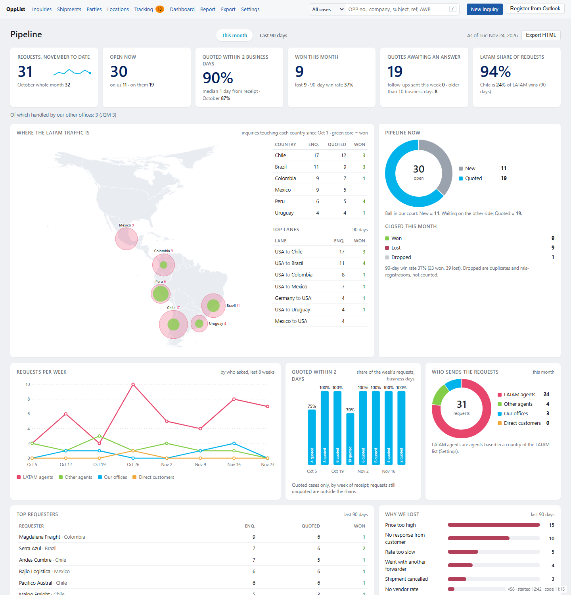
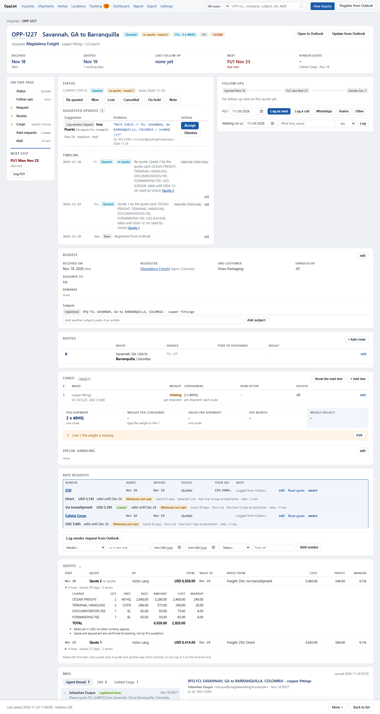
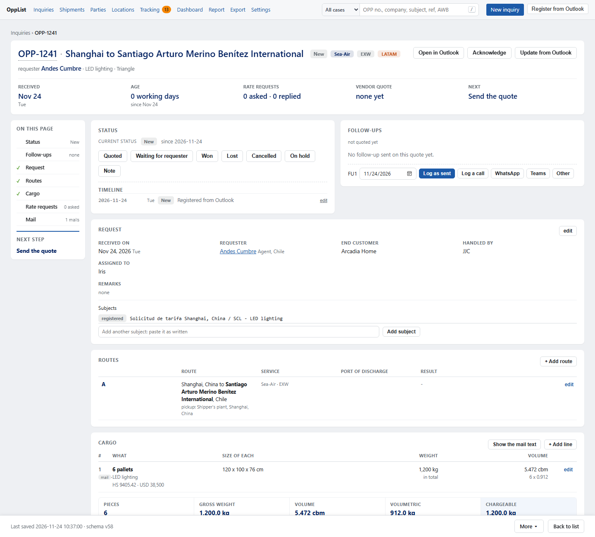
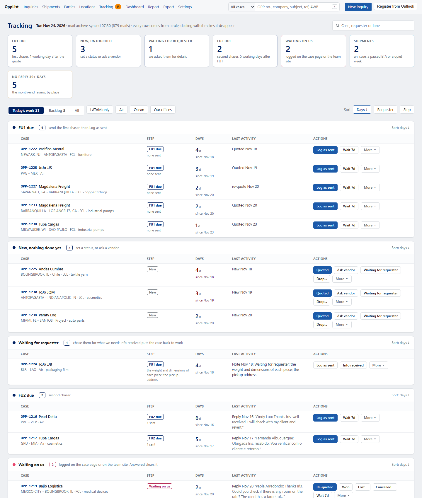
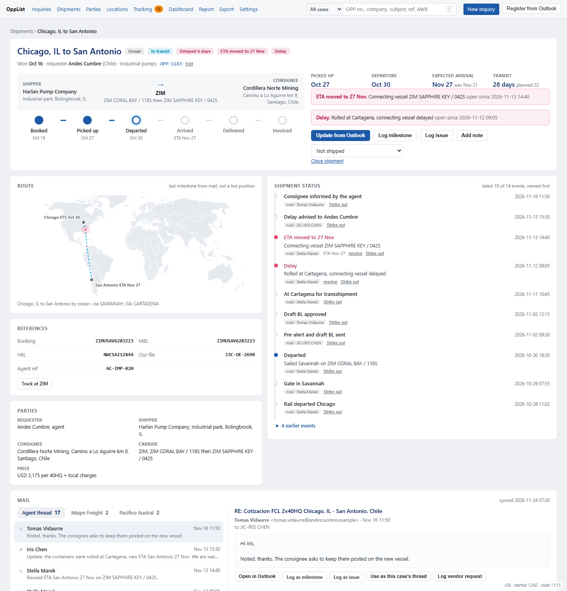
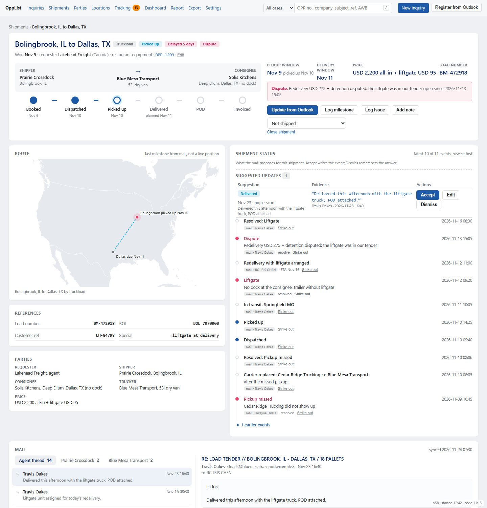
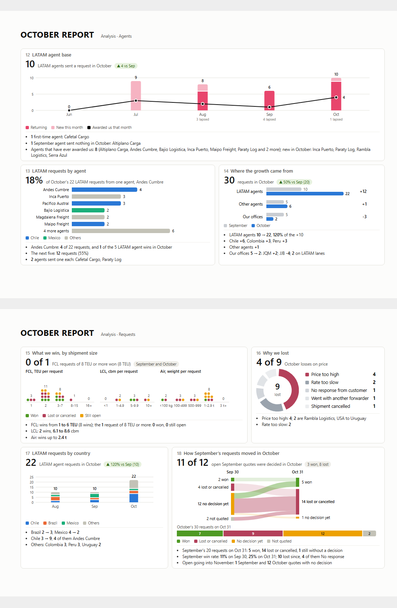
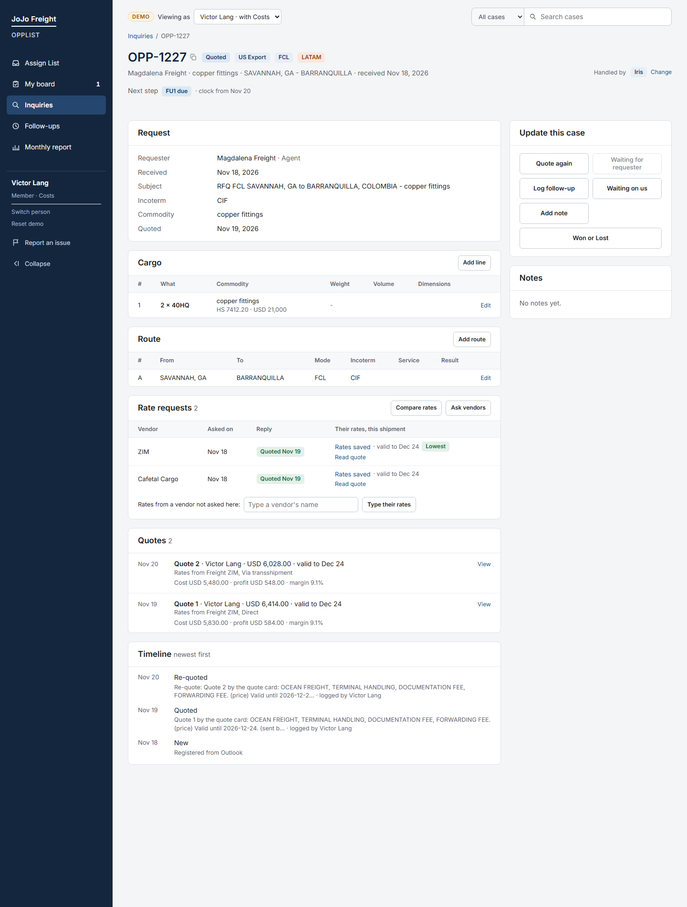
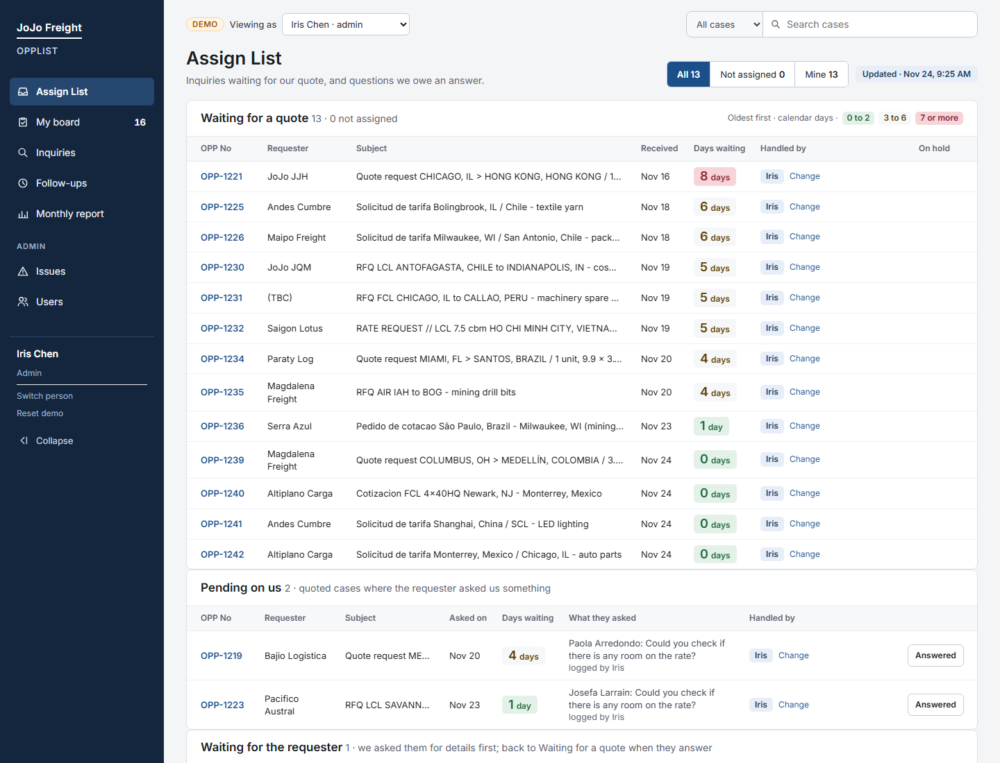

# OppList

**Enquiry registration and follow-up tracking for a freight forwarder's inside
sales desk.** A local Flask + SQLite app that turns rate requests arriving by
mail into cases, tells you every morning what needs chasing, and follows a won
case through to delivery. A second half, the **team site**, lets the rest of the
team see the lists and do their part of the work from a browser.

This repository is a portfolio copy. It runs entirely on **synthetic data** for a
fictional forwarder, *JoJo Freight* (offices JJC Chicago, JQM Miami,
JJH Hong Kong, JJS Shanghai, JJB Bangalore). Every company, person, address,
reference and price in the code, tests, fixtures and demo data is invented. The
outside services the working tool talks to are replaced here by local stand-ins,
so nothing in this repository opens a network connection (see
[What is offline here, and why](#what-is-offline-here-and-why)).



## The problem

An inside sales desk at a forwarder lives in its inbox. Overseas agents,
our own offices and a few direct customers send rate requests ("RATE REQUEST //
FCL // SAVANNAH - IQUIQUE"); the desk asks carriers and partner agents for
buy rates, quotes, chases, and eventually hears won, lost or nothing. The work
was tracked in a spreadsheet, which meant:

- requests were typed in by hand, or not at all, and duplicates slipped through;
- nobody could say which quotes were waiting on a follow-up today;
- "who won, and whose rate did we use" was lost as soon as the thread went quiet;
- monthly reporting was an evening of pivot tables;
- only the person with the spreadsheet open knew where a case stood.

OppList keeps one record per request, fills it from the mail, and derives the
worklist, the follow-up ladder and the reports from the events it records. The
team site shares that picture with everyone else.

## Features

**Register from Outlook.** Select a mail in Outlook, press one button: the
requester (from the sender, the quoted chain under our own reply, the office
prefix on a colleague's display name, or the external domains on To/CC), the
routes (from the subject or the body, including Spanish and Portuguese wording),
mode, quantities, incoterm and cargo lines are pre-filled with where each value
came from. A duplicate check shows cases that look like the same request.
Nothing is saved until you confirm.

**Case page.** One page per case, in cards: status and timeline, follow-ups,
the request, its routes (one case can ask for more than one destination), cargo
lines with weights, volumes, containers, HS codes and cargo values, the rate
requests with each vendor's rates and options, the quotes made for it with their
costs and margins, the mail thread behind the case (read from the local
archive), and suggested updates read from the mail.



**Modes.** Air, FCL, LCL, RORO, Break Bulk, Project, Truck, and the two
combined ones: Sea-Air (charged on air weight, because the last leg flies) and
Cross-border Truck.



**Tracking.** The daily worklist: new cases nobody has acted on, vendors that
have not replied, quotes on the follow-up ladder (FU1, FU2, Decide), cases
waiting for the requester to send what is missing, questions we owe an answer,
replies that need one, won cases without a recorded rate, locations to fix,
partners to touch base with, shipments with an issue or a passed ETA, and
suggested updates read from the mail archive. Every row comes from a rule;
dealing with it makes it disappear.



**Waiting for requester.** A New case that cannot be quoted until the requester
sends something (the dimensions, the pickup address) is marked as waiting, with
what we need. It leaves the "nothing done yet" list and gets a follow-up ladder
of its own, until they answer or someone presses Info received.

**Follow-ups without sending mail.** Draft FU1 composes a follow-up from rotating
template pools; you copy it into Outlook and log it with one click. Replies are
picked up from the archive and put the case back on the list.

**Vendors' rates and quotes.** Each vendor's rates are kept per case and route as
versions, never overwritten, with their lines, validity, transit, carrier, free
time and what the vendor said about fuel, local charges and minimums. A vendor
can offer options (direct or via transshipment, two carriers). The quote card
builds the quote to the requester from them: the lines, the markup and margin
for the people allowed to see costs, the mail, and a PDF quotation. A re-quote is
a second version of the quote on the same case.

**Read quote.** A vendor's reply (the mail, its PDFs and pictures, or a pasted
message) can be read by a language model into a draft of that vendor's rates. A
person checks the draft line by line against the mail and saves it, or sets it
aside; nothing becomes a rate until then. In this copy the readings come from
recorded answers (see below).

**Shipments.** A won case becomes a shipment (ocean, air or truck) with its
milestones, references, parties, issues and ETA changes. "Update from Outlook"
proposes milestones and issues from the mails that mention the booking; you
accept or dismiss each. The route is drawn on a world map, or a US map for
domestic trucking.





**Dashboard, month report, inquiries workbook.** Requests, quote speed, win rate,
the pipeline, who sends the requests, top lanes and requesters, and why we lost,
all as inline SVG generated in Python. The month report has five pages: an
overview, the regions, the agents, and two pages of analysis (the agent base and
where the growth came from; what we win by shipment size, why we lose, and how
last month's open quotes ended). It exports to one self-contained HTML file, to
PDF and to xlsx. The month's inquiries also export as a fixed-format workbook,
and the Report page lists every cell that still needs a value.



**Also:** parties with contacts, domains, groups and merge; direct customers as
their own kind of requester; a master location list with aliases and
coordinates; xlsx / CSV exports in fixed formats; restore points before every
bulk change; a consistency check that lists and never fixes.

## The team site

OppList runs on one computer. The team site is a small web app for the rest of
the team: the Assign List (who takes which new request), My board (what I owe an
answer, what is due, my notes), Inquiries, Follow-ups, each case with its
drawers (ask vendors for rates, type a vendor's rates, compare them, build the
quote and its PDF, log a follow-up, send a Won or Lost with the mail that says
so), the Monthly report, and for the administrator Issues and Users.

OppList stays the master. Every few minutes it pushes its lists to a document
store the site reads, and it takes in what people did on the site as *actions*:
it applies each one through the same code its own buttons use, records it, and
answers it (applied, or refused with a sentence for the person). Until OppList
has taken an action in, the site lays it over the lists, so everyone sees it at
once. A Won or Lost sent from the site waits for the administrator to confirm.
Costs, markups and margins are visible only to the administrator and the people
ticked for Costs.



The copy of the site in [`site/`](site/) runs in a browser on the demo data,
with no account and no server behind it: a "Viewing as" switch replaces
sign-in, and what you do is kept in your browser until you press Reset demo.
[`site/README.md`](site/README.md) says what stands in for what.



## Quickstart

Python 3.10 or newer.

```sh
pip install -r requirements.txt
./run_demo.sh            # macOS / Linux  (or: sh run_demo.sh)
run_demo.cmd             # Windows
```

Then open <http://127.0.0.1:8766> for OppList and <http://127.0.0.1:8766/site/>
for the team site. The script sets `OPPLIST_DATA_DIR=demo`, generates the demo
data on first run and serves it. Use `PORT=8800` to pick another port.

The demo data is generated relative to today, so the Tracking page always has
something due:

```sh
python -m opplist demo --out demo --seed 42          # same seed + same day = same bytes
python -m opplist demo --out demo --seed 42 --force  # replace (restore point first)
```

It contains about 35 parties (agents in Latin America, Asia and Europe, the five
JoJo offices, two direct customers, three carriers), 97 ports, airports and
cities with coordinates, 142 enquiries over five months in every status and
mode, about 220 vendor requests, follow-ups, re-quotes and notes, accepted and
pending suggestions, three shipments (ocean with a via point and an ETA slip,
air, and a US truckload with a liftgate dispute and a replaced carrier), and a
mail archive of about 880 synthetic messages in English, Spanish and Portuguese.

On top of that, the demo does some of the work the team site is for, through
the same code that takes in the site's actions: one case has two vendors' rates
(one vendor with two options) and two quotes with their costs; one case waits for
the requester; one asks for a second destination; a vendor's reply has been read
by Read quote and waits to be checked. The site's snapshot
(`demo/site/snapshot.json`) is written by OppList's own push code from the same
database, with the documents the site wrote for that work, and one Won sent
from the site after OppList's last sync, waiting to be taken in.

Run the tests:

```sh
python -m pytest -q                                    # the app, the demo, the site's snapshot
for f in site/tests/*_test.mjs; do node "$f"; done     # the site's own unit tests (Node, no packages)
```

The site's unit tests also run in a browser at `/site/tests/run.html`, and
`/site/tests/e2e.html` clicks through the site.

**Outlook.** Reading mail uses classic Outlook through COM (pywin32) and is
Windows only. Without pywin32 or Outlook, every Outlook action shows a notice
and the rest of the app works; the demo reads its synthetic mail archive
instead. The app never creates, moves, deletes or sends mail.

## What is offline here, and why

The working tool talks to three services outside the computer: the hosted
document store behind the team site, a second store (the Rate Card) that
receives the vendors' costs, and a language model API for Read quote. A
portfolio copy must not carry keys, project ids or addresses of real projects,
and its tests and demo must run on any machine with no network. So each service
sits behind one seam, and the rest of the code is the same as in the working
tool:

| Service | In this copy |
|---|---|
| The team site's document store | `opplist/local_store.py`: a folder of JSON documents that answers the same three calls (commit, get, query). The push, the take-in of actions, the guards and the status lines are the working code. Off by default; the demo turns it on. |
| The Rate Card | The same local store, a folder of its own. |
| Read quote's language model | `opplist/read_quote_recorded.py`: the request that would go out is answered from a recording in `fixtures/read_quote/`. The prompt, the answer's schema, the checks, the rules that turn an answer into drafts and warnings, and the cost and cap arithmetic are the working code. The one HTTP call is never made without a key, and no key ships. |
| The team site itself | `site/`: the site's own pages on an in-memory store loaded from one snapshot file. See [`site/README.md`](site/README.md). |

`tests/test_offline.py` checks that no key, account or hosted project is named
anywhere, that the package imports no service or HTTP client, and that only
Read quote's one function could open a connection.

## Architecture in brief

```
opplist/
  web/            Flask routes, Jinja2 templates, one CSS file, plain JS, map data
  db.py           Repository: every write goes through it and writes change_log
  schema.sql      the current schema; schema_migrations.py upgrades older files
  status.py tracking.py followup.py wait.py shipments.py cargo.py   domain rules
  parsing.py intake.py matching.py dedupe.py                        reading mail
  outlook_bridge.py mail_archive.py case_mail.py                    Outlook and the archive
  propose.py detect_followups.py suggestions.py                     suggestions from mail
  export_*.py report.py monthly*.py dashboard.py inquiries_xlsx.py  output
  firebase_sync.py firebase_pull.py site_*.py local_store.py        the team site: push and take-in
  read_quote.py read_quote_recorded.py ratecard_sync.py             Read quote, the Rate Card
  branding.py paths.py                                              configuration
  demo.py demo_world.py demo_showcase.py site_snapshot*.py          synthetic data
site/             the team site, offline (plain ES modules, no build)
tests/            pytest suite; fixtures/ has the synthetic sample mails and recorded readings
```

- **SQLite with views as the single source of derived values.** Month, region,
  direction, TEU, quote and close dates, follow-up counts and quote rounds are
  defined once in `v_enquiry` / `v_party_stats`; pages, rules and exports read
  the views.
- **Events, not fields.** Status, follow-ups and re-quotes are rows in
  `status_event`; the current status and every date are derived.
- **Nothing is deleted**: close, void, merge, soft-delete. Every change is in
  `change_log`; every bulk operation takes a restore point and is re-runnable.
- **Parsing suggests, the user confirms.** The same holds for the mail scans and
  for Read quote.
- **One master, many hands.** The team site never changes OppList's data; it
  sends actions, and OppList applies them with its own code.

See [ARCHITECTURE.md](ARCHITECTURE.md) for modules, the data model, the tracking
rules, the mail pipeline, the team site's documents and actions, migrations and
the coordinate rules, and [DECISIONS.md](DECISIONS.md) for the design decisions
behind them.

## Tech choices

| Choice | Why |
|---|---|
| Flask + Jinja2, no front-end build | One user on one machine; server-rendered pages are fast and stay maintainable without a toolchain |
| SQLite, WAL, foreign keys on | One file, easy to back up and restore; views keep derived values in SQL |
| Plain JavaScript, one stylesheet | Small enhancements only: dialogs, sorting, column choice |
| The team site as plain ES modules | No build step either; the same files run in a browser and, for the pure-function modules, in Node's test runner |
| Inline SVG drawn in Python | Charts and maps without a chart library or network access; exports are self-contained |
| pywin32 for Outlook, read-only | The desk runs classic Outlook on Exchange; no Graph or IMAP was available |
| pytest, real-shaped fixtures | Parsing rules are tested against sample mails with the same structure as the real ones |
| Server bound to 127.0.0.1 | Single-user tool; no login, nothing exposed on the network |

## Coordinates

`master_location` carries lat / lon, which the maps use. They are filled once,
offline, by

```sh
python -m opplist fill-coordinates --unlocode <UN/LOCODE zip, folder or CSV> --airports airports.csv [--apply]
```

from two public sources: the **UNECE UN/LOCODE** code list (seaports and cities,
coordinates in degrees and minutes) and the **OurAirports** `airports.csv`
(airports by IATA code). A manual CSV (`--manual`) is applied first and wins.
The dry run writes a CSV of what it would set; `--apply` takes a restore point
first. The source files are not in this repository: download them yourself.
The demo data already has coordinates filled.

## Keeping company data out

The copy was made from a working internal tool. Company facts are routed
through `opplist/branding.py` and settings with neutral defaults, and
`python -m opplist leakcheck --list <file>` scans every publishable file
(including JSON escapes, URL-encoded links, and the text inside SQLite files)
against a list of forbidden strings kept outside the repository.
`tests/test_no_company_data.py` runs the same check whenever that list is
present, and the demo generator runs it on everything it writes, the site's
snapshot included.

The sample mails under `fixtures/` and in the tests were written from scratch
for this copy: each one keeps only the shape its test needs (a quoted chain, a
reply prefix, a table of pieces and dimensions, a sentence that states a plan)
around invented lanes, prices, references and addresses. The team site's
company wording (its standard quotation terms, charge names, mail sentences)
was written new as well, and its PDF carries a plain JoJo Freight wordmark drawn
in type. Every mail address and URL is on a reserved `.example` or `.test` name,
apart from a short list of public reference sites and a few invented demo
domains with country endings; `tests/test_domains.py` enforces that on every
tracked file, on CI as well.

## License

MIT, see [LICENSE](LICENSE).

### Third-party files

All three map files in `opplist/web/static/` are Natural Earth 4.1.0 country
boundaries (public domain), taken from the TopoJSON of
[world-atlas](https://github.com/topojson/world-atlas) 2.0.2 (ISC license) and
projected with d3-geo into SVG paths:

| File | Used by | Source |
|---|---|---|
| `americas.json` | dashboard map | world-atlas `countries-50m` |
| `usmap.json` | US truck routes | world-atlas `countries-50m` |
| `worldmap.json` | ocean and air routes | world-atlas `countries-110m` |

The team site ships jsPDF 4.2.1 (MIT) and the fonts Inter and Newsreader (SIL
Open Font License); see [`site/README.md`](site/README.md).
